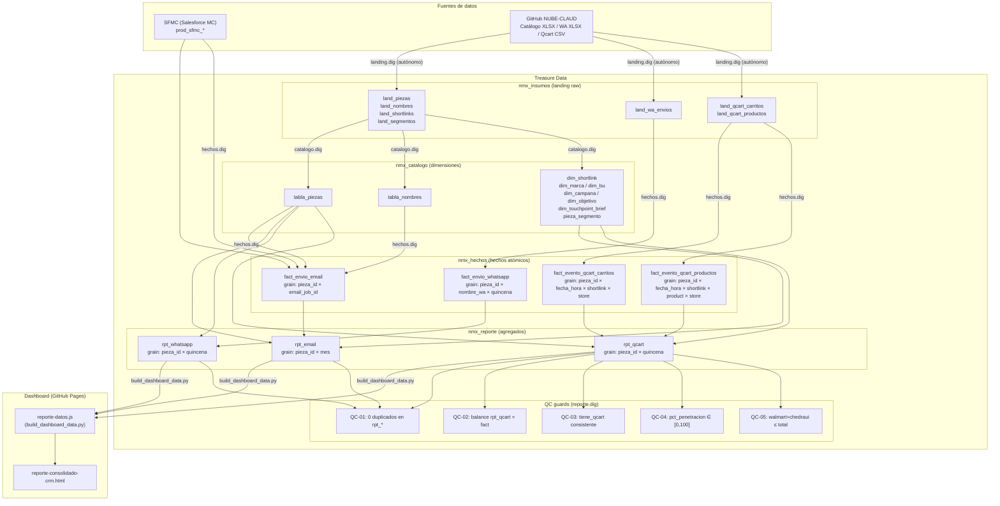
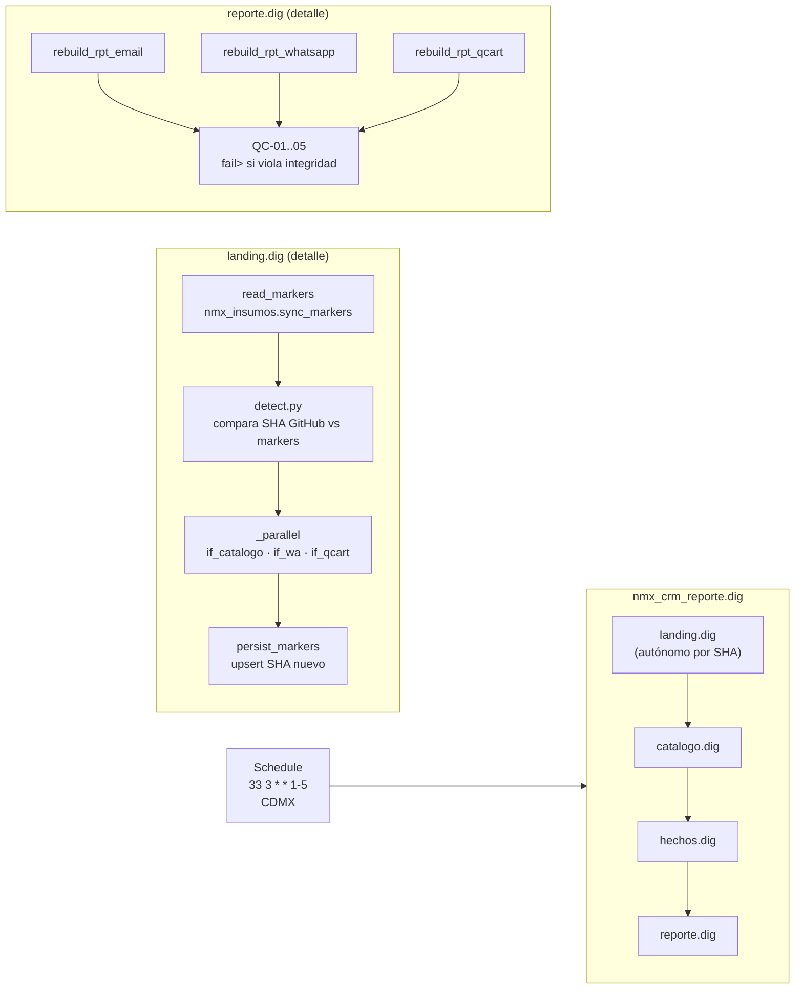
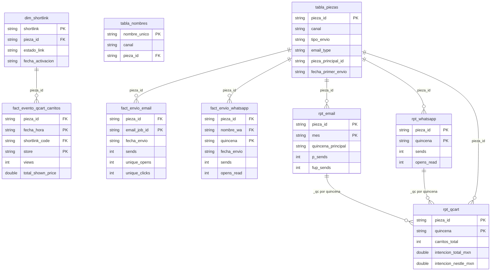
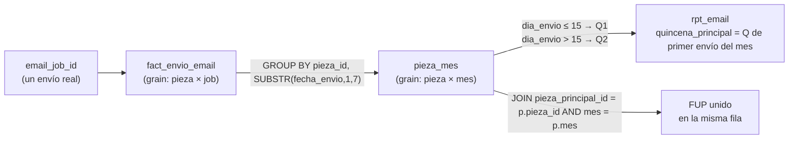
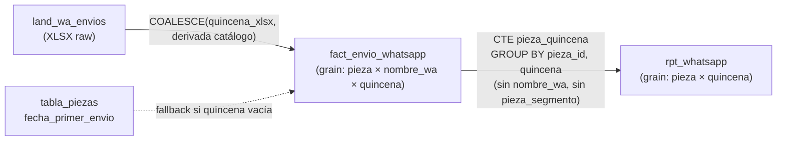
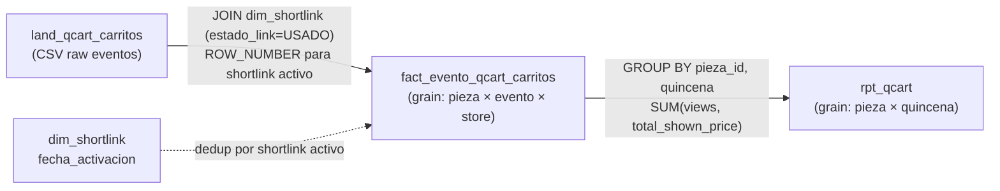
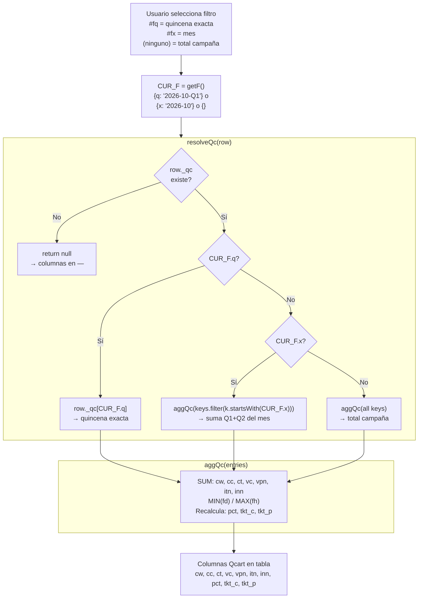

# ARQUITECTURA: CRM Reporte Consolidado Nestlé México

> Documento de referencia permanente. Actualizado 2026-11-13 tras sesión de auditoría completa.

---

## 1. Visión general del sistema



---

## 2. Pipeline de ejecución — Digdag



**Regla de orden:** `catalogo.dig` siempre primero — `tabla_piezas` stale rompe `tipo_envio` en todos los `rpt_*`.

**Secret names definitivos:**
- `${secret:github_pat_dashboards}` — lectura de GitHub
- `${secret:td.apikey}` — escritura a TD

---

## 3. Modelo de datos — grains y relaciones



---

## 4. Modelo de atribución por canal

### Email



**Regla:** opens y clicks se atribuyen al `email_job_id` → quincena del envío, **no** de la apertura/clic.
Para AON con sends en Q1 y Q2 del mismo mes: ambos jobs agregan al mismo `mes`, y `quincena_principal` = Q del **primer** envío.

### WhatsApp



**Fallback fechas (BUG-12):** cuando `send_date`/`quincena`/`mes` vienen en blanco del XLSX, se deriva desde `tabla_piezas.fecha_primer_envio`. Aplica a las 5 piezas WA-MUNDIAL-*.

### Qcart



**Dedup de shortlinks:** cuando un shortlink aparece en 2 piezas distintas (distinta `fecha_activacion`), el evento se atribuye a la pieza con `fecha_activacion` más reciente que sea ≤ fecha del evento.

---

## 5. Filtro de período en el dashboard (JavaScript)



**Estructura `_qc` en reporte-datos.js:**
```json
{
  "pieza_id": "001-P001",
  "_qc": {
    "2026-10-Q1": {"cw":120,"cc":34,"ct":154,"vc":890,"vpn":1200,"itn":59000,"inn":5100,"pct":8.6,"tkt_c":383,"tkt_p":4.25,"rec":"Receta X","fd":"2026-10-01","fh":"2026-10-15"},
    "2026-10-Q2": {"cw":80,"cc":20,"ct":100,"vc":600,"vpn":800,"itn":38000,"inn":3200,"pct":8.4,...}
  }
}
```

---

## 6. QC Guards — `reporte.dig`

| Check | Qué valida | Falla si |
|---|---|---|
| QC-01 | 0 duplicados en `rpt_qcart`, `rpt_email`, `rpt_whatsapp` | COUNT(*) > 1 para (pieza_id, quincena/mes) |
| QC-02 | Balance `rpt_qcart` ≈ `fact_qcart_carritos` | `rpt_carritos ≠ fact_carritos` |
| QC-03 | `tiene_qcart = 'Sí'` ↔ existe dato en `rpt_qcart` | Inconsistencia en cualquier pieza |
| QC-04 | `pct_penetracion ∈ [0, 100]` | Alguna fila > 100% o negativa |
| QC-05 | `carritos_walmart + carritos_chedraui ≤ carritos_total` | Alguna fila viola la restricción |

Si cualquier QC falla: `fail>` aborts el intento — `reporte.dig` **no entrega datos corruptos**.

---

## 7. Nomenclatura de piezas

```
{marca_id}-P{nnn}
Ejemplo: 001-P001 (Nescafé Clásico, pieza 1), 004-P010 (Maggi, pieza 10)
```

| Prefijo | Marca |
|---|---|
| `001` | Nescafé Clásico |
| `002` | Nescafé Decaf |
| `003` | Coffee Mate |
| `004` | Maggi |
| `005` | La Lechera / Carnation |
| `006+` | Otras marcas Nestlé MX |

---

## 8. Canales y tipos de envío

| Canal | `tipo_envio` | Grain rpt | Quincena base |
|---|---|---|---|
| Email | `always-on` (AON) | `(pieza_id, mes)` | Primer envío del mes |
| Email | `one-shot` (OS) | `(pieza_id, mes)` | Primer (y único) envío del mes |
| WhatsApp | `one-shot` | `(pieza_id, quincena)` | `send_date` del XLSX (o `fecha_primer_envio` del catálogo) |
| Qcart | — | `(pieza_id, quincena)` | `fecha_hora` del evento |

---

## 9. Repositorios y archivos clave

| Componente | Repositorio | Ruta |
|---|---|---|
| Dashboard HTML | `CRM-Omnicom-Clients/Dashboards-Nestle-MX` | `dashboards/reporte-consolidado-crm.html` |
| Datos dashboard | `CRM-Omnicom-Clients/Dashboards-Nestle-MX` | `dashboards/reporte-datos.js` |
| Build script | `CRM-Omnicom-Clients/Dashboards-Nestle-MX` | `negocio/nestle/reportes-consolidado/workflow/scripts/build_dashboard_data.py` |
| Workflow SQL | TD Digdag project `nmx_crm_reporte` (ID 2105350) | `queries/hechos/`, `queries/reporte/`, `queries/validate/` |
| Workflow SQL local | CRM (carpeta compartida) | `my/workflow/queries/` |
| Catálogo insumos | `RickAguilarOmnicom/NUBE-CLAUD` | `negocio/nestle/reportes-consolidado/insumos/` |

---

## 10. Commits relevantes (cronológico)

| Commit | Descripción | Fecha |
|---|---|---|
| `323c9a9` | fix: _qc formato correcto (lista → objeto agregado) | 2026-11-12 |
| `6d6ab24` | fix OI-18: 0 duplicados en rpt_* (BUG-10) | 2026-11-12 |
| `3310f29` | fix BUG-05: intencion_nestle filtro brand incorrecto | 2026-11-12 |
| `f918371` | fix BUG-06+07: pct NULL cuando inn>itn, store dual | 2026-11-12 |
| `87ad014` | docs: OI-13 cerrado (cobertura shortlinks intencional) | 2026-11-13 |
| `3618d4e` | feat: filtro período Qcart (_qc por quincena, resolveQc) | 2026-11-13 |
| `ffbfbc4` | fix: 34→18 filas rpt_whatsapp (BUG-11-WA) | 2026-11-13 |
| `2052a54` | fix: WA Mundial fechas desde catálogo + QUALIFY→ROW_NUMBER (BUG-12/13) | 2026-11-13 |
